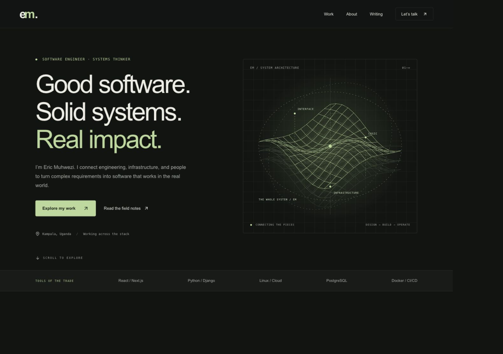
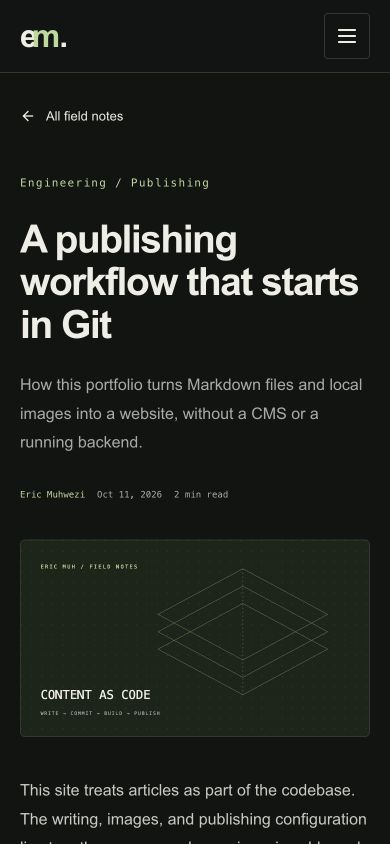

<p align="center">
  
</p>

<p align="center">
  <strong>Software engineer · Systems administrator · Technical leader</strong><br/>
  Kampala, Uganda &nbsp; / &nbsp; Software. Systems. People.
</p>

<p align="center">
  <a href="https://ericmuh.com">Portfolio ↗</a> &nbsp; · &nbsp;
  <a href="https://www.linkedin.com/in/eric-muhwezi/">LinkedIn ↗</a> &nbsp; · &nbsp;
  <a href="mailto:ericmhwz@gmail.com">Get in touch ↗</a>
</p>

---

<p align="center">
  <a href="#the-work">The work</a> &nbsp; / &nbsp;
  <a href="#inside-the-portfolio">The portfolio</a> &nbsp; / &nbsp;
  <a href="#run-it-locally">Run locally</a> &nbsp; / &nbsp;
  <a href="#write--commit--publish">Publish writing</a> &nbsp; / &nbsp;
  <a href="#deployment">Deployment</a>
</p>

## The work

I connect software engineering, infrastructure, and people to turn complex requirements into practical systems. My work spans full stack applications, Linux and cloud environments, technology consulting, and technical education.

At **Refactory**, I coordinate industry-based software projects through requirements, architecture, testing, deployment readiness, and handover. My consulting work with **Agatech** covers technical discovery, application development, production environments, and ongoing support. I also bring experience in systems consulting and hands-on Python education.

| Build                        | Operate                      | Guide                           |
| :--------------------------- | :--------------------------- | :------------------------------ |
| React · Next.js · TypeScript | Linux · Nginx · Docker       | Requirements & architecture     |
| Python · Django · APIs       | Cloud hosting · CI/CD        | Technical delivery & mentorship |
| Web · Mobile · Databases     | Backups & production support | Documentation & handover        |

Much of this work lives in private client environments. This space focuses on public work and engineering practice rather than contribution counts or popularity metrics.

## Inside the portfolio

**Eric MUH / Digital workspace** is a home for my work and technical writing: a dark editorial interface, an original wireframe identity, and a publishing system built around the tools I already use.

- **Designed with intent:** charcoal, ivory, and sage; restrained motion; responsive layouts; keyboard navigation and reduced-motion support.
- **Content as code:** Markdown articles, metadata, and images live in this repository.
- **Static by design:** Next.js produces finished pages; Hostinger serves them without a running application backend.
- **Small client footprint:** article parsing and syntax highlighting happen during the build. Only the navigation menu needs client state.
- **Checked before publishing:** malformed metadata, missing images, and invalid dates stop the build.

<details>
<summary><strong>See the interface: desktop & mobile reading</strong></summary>



<p align="center"></p>

These previews are captured from the static export. The live domain awaits Hostinger configuration.

</details>

<details>
<summary><strong>Explore the architecture</strong></summary>

```text
content/articles/*.md  ──→  validate & render  ──→  out/articles/<slug>/index.html
public/images/         ──→  copy local assets ──→  out/images/
app/                   ──→  Next.js build    ──→  static portfolio
                                                   ↓
                                              Hostinger
```

| Location                 | Purpose                                                  |
| ------------------------ | -------------------------------------------------------- |
| `app/page.tsx`           | Portfolio, experience, featured work, and recent writing |
| `app/articles/`          | Article index and generated article pages                |
| `app/lib/articles.ts`    | Discovery, validation, rendering, reading time           |
| `content/articles/`      | Markdown files; filenames become stable URLs             |
| `public/images/`         | Original graphics, covers, and article images            |
| `app/styles/globals.css` | Shared visual system and responsive styles               |
| `.github/workflows/`     | Verification, build artifacts, optional deployment       |

**Runtime:** React + Next.js + TypeScript. **Build tools:** YAML, markdown-it, highlight.js. **Icons:** Lucide SVGs. No CMS, content API, database, remote font service, or statistics widget.

</details>

## Run it locally

Use **Node.js 22 or newer** and npm.

```bash
git clone https://github.com/ericmuh/ericmuh.git
cd ericmuh
npm ci
npm run dev
```

Open [localhost:3000](http://localhost:3000).

| Command                 | Purpose                                                 |
| ----------------------- | ------------------------------------------------------- |
| `npm run dev`           | Local editing and previews                              |
| `npm run content:check` | Validate all articles, including drafts                 |
| `npm test`              | Content discovery, metadata, image, and rendering tests |
| `npm run lint`          | Check application and publishing code                   |
| `npm run build`         | Validate content and generate the static site in `out/` |
| `npm run preview`       | Serve the built site; requires Python 3                 |

## Write → commit → publish

Create `content/articles/my-article.md`:

```markdown
---
title: "My article"
date: "2026-10-11"
description: "What this article helps the reader understand."
tags: ["Engineering"]
cover: "/images/articles/my-cover.webp"
coverAlt: "A meaningful description of the cover"
draft: false
---

## Start with the problem

Write here. Add images stored in this repository:


```

Put the referenced images in `public/images/articles/`, preview locally, then:

```bash
npm run content:check
npm test
npm run build
git add content/articles/my-article.md public/images/articles/
git commit -m "content: publish my article"
git push origin main
```

The next build discovers the file automatically and creates `/articles/my-article/`. No application code or registry needs changing.

**GitHub saves the source. The build creates the pages. Deployment updates the live website.** A push only updates Hostinger after deployment is configured.

<details>
<summary><strong>Drafts, dates, images, and code blocks</strong></summary>

- `draft: true` excludes a file from website pages. It remains visible in a public repository.
- Drafts are still validated. To preview one, temporarily set it to false locally.
- Dates must be quoted `YYYY-MM-DD` values. They are not a publication scheduler.
- Filenames are stable URLs; renaming a published file changes its URL.
- Images must exist under `public/images/` and have alt text. Remote article images are rejected.
- Standard Markdown supports headings, lists, links, tables, quotes, and fenced code blocks with language highlighting.
- Raw HTML is escaped and executable MDX is not supported.

See the complete [authoring guide](docs/PUBLISHING.md). The repository includes one published implementation note and one unpublished starter draft.

</details>

## Deployment

`npm run build` creates **`out/`**, ready for static hosting on Hostinger. Upload its contents to the domain's dedicated `public_html`, preserving subdirectories and `.htaccess`.

Every push to `main` runs the verification workflow and stores a downloadable static-site artifact. The optional SSH deployment workflow is **disabled until explicitly configured**. No hosting credentials belong in the repository.

Follow the [Hostinger setup guide](docs/HOSTINGER.md) to verify the hosting plan, set GitHub secrets, confirm the destination, and enable automatic deployment. Live deployment is pending hosting configuration; repository source changes do not imply that the live domain has been updated.

---

<details>
<summary><strong>Design references & content notes</strong></summary>

The structure draws inspiration from [Brittany Chiang](https://brittanychiang.com/), [Lee Robinson](https://leerob.com/), and [Best README Template](https://github.com/othneildrew/Best-README-Template). The layout and repository-hosted artwork are original to this project.

Professional content is grounded in the supplied CV. Client project details are included only when suitable for public sharing. See [design and provenance notes](docs/DESIGN.md).

</details>

<p align="center"><sub>Built with intent by Eric Muhwezi. A workspace for useful software and the thinking behind it.</sub></p>
